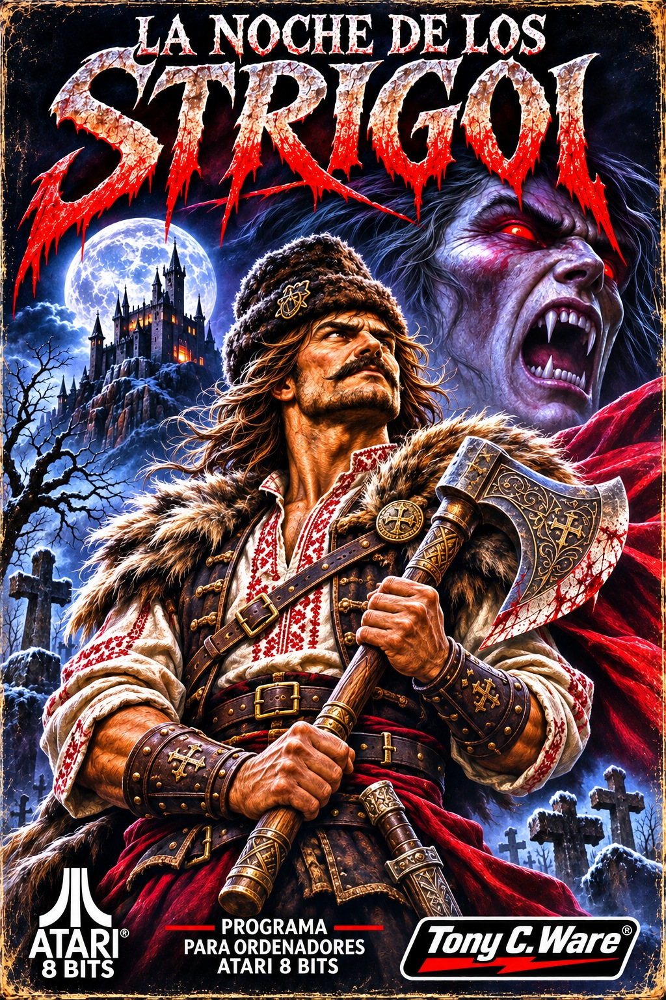

# LA NOCHE DE LOS STRIGOI

**Atari 8 bits (XL/XE) · Versión 1.0 · © 2026 Tony C. Ware**

## Historia

Sighișoara, Transilvania, 1847. Al caer la noche del solsticio de invierno, las campanas de la colina anuncian una desgracia: los Strigoi han quebrado el sello del inframundo y regresan para reclamar la carne de los vivos.

Tras años de conflictos, la vida en la ciudadela y en las aldeas cercanas parecía haber recuperado la calma. Ahora las familias cierran sus puertas, cuelgan ajos en los dinteles y aprietan en su pecho cruces de madera.

Solo Radu, un haiduc de los Cárpatos, se atreve a cruzar el cementerio. Con su baltag y lo que sabe de montañas y bosques, tendrá que llegar al Trono de Sangre y acabar con el señor de la noche antes de que amanezca.

## Descargar y jugar

Consulta la [Release V1.0](../../releases/tag/v1.0) para descargar:

| Archivo | Plataforma |
|---|---|
| `strigoi.car` | Atari XL/XE con 64 KB: cartucho AtariMax 8 Mbit (tipo 42) |
| `strigoi.atr` | Atari XL/XE con 64 KB: disco autoarrancable |
| `Strigoi_130XE.xex` | Atari 130XE con 128 KB |
| `La_Noche_de_los_Strigoi_VERSION_FINAL.zip` | Proyecto completo: fuentes, manuales, capturas, música y versiones jugables |

**Importante:** el XEX exige 128 KB; para equipos de 64 KB usa el ATR o el CAR. Vídeo NTSC.

**Controles:** joystick izquierda/derecha para caminar; arriba salta, abajo agacha; FIRE lanza el baltag. En título, izquierda/derecha eligen Normal o Hardcore; FIRE empieza.

## El recorrido

1. El Cementerio de la Colina y la Escalera Cubierta — Strigoi Mort y su lobo.
2. La Ciudadela y las Torres de los Gremios — Aric, el Sastre de las Sombras.
3. Las Minas de Sal y las Criptas — Muma Pădurii.
4. El Paso de los Cárpatos — Căpcăun y Rey Strigoi alado.
5. El Castillo del Trono de Sangre — cabeza del Rey Strigoi.

## Documentación y fuentes

- [Instrucciones ilustradas](documentos/Strigoi_Instrucciones.pdf).
- [Atlas y memoria visual](documentos/Strigoi_Atlas_y_Memoria.pdf).
- [Carátula para imprimir](documentos/Strigoi_Caratula_Oficial_Para_Imprimir.pdf).
- `codigo_fuente/`: fuentes 6502, recursos y script `build_all.sh` (cc65 2.19, Python 3 y Pillow).
- `banco_de_trabajo_atari8bits/`: banco de desarrollo.
- `capturas/`: capturas reales del juego.
- `banda_sonora/`: seis temas en MP3.

## Créditos

**Tony C. Ware · 2026.** Proyecto independiente para Atari 8 bits. Atari es marca de sus respectivos titulares y no patrocina este proyecto.

Consulta `LICENSE` para las condiciones del código; las marcas y otros contenidos con derechos independientes conservan sus respectivos derechos.
